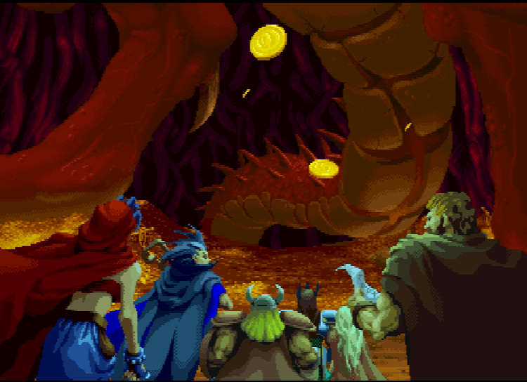
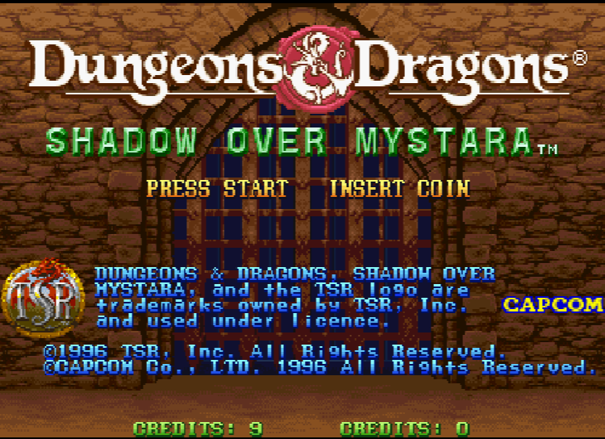
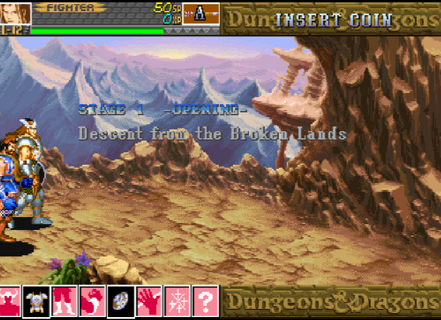
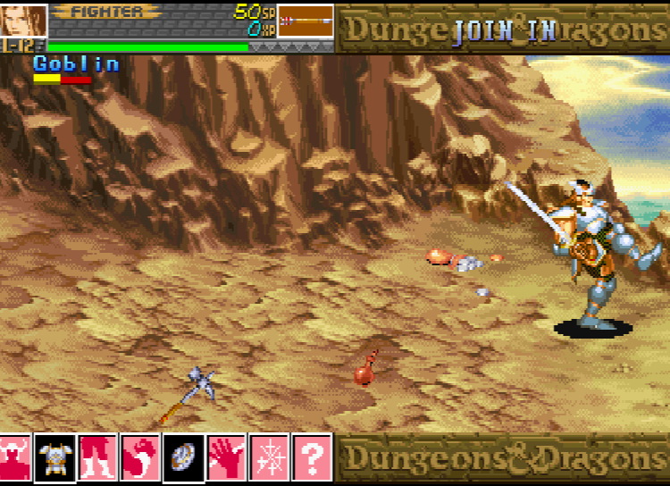
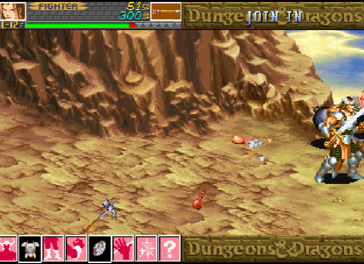

# Dungeons & Dragons: Shadow over Mystara (Nintendo 64)

Port nativo de Dungeons & Dragons: Shadow over Mystara (arcade CPS-2) para Nintendo 64 via recompilação estática.

## Galeria


*Abertura (captura no emulador Ares v148)*

| | |
|---|---|
| <br>Tela de título | <br>Início da Fase 1 |
| <br>Combate | <br>Combate |

Capturas no emulador Ares v148.

## Aviso legal

O repositório NÃO contém ROM, chave de descriptografia, gráficos, sons nem código gerado a partir do jogo. Cada usuário deve utilizar sua própria cópia da ROM original.

Arquivos necessários da ROM (versão europeia `ddsom`, 21 arquivos colocados em `rom/ddsom/`):
- Programa 68000 (8 arquivos): `dd2e.03e`, `dd2e.04e`, `dd2e.05e`, `dd2e.06e`, `dd2e.07`, `dd2e.08`, `dd2e.09`, `dd2e.10`
- Gráficos (8 arquivos): `dd2.13m`, `dd2.14m`, `dd2.15m`, `dd2.16m`, `dd2.17m`, `dd2.18m`, `dd2.19m`, `dd2.20m`
- Programa de som Z80 (2 arquivos): `dd2.01`, `dd2.02`
- Amostras de som (2 arquivos): `dd2.11m`, `dd2.12m`
- Chave de descriptografia (1 arquivo): `ddsom.key`

## Como funciona

- CPU 68000 recompilada estaticamente para C++ nativo (`tools/recomp.py --native-time`).
- Vídeo gerado no RDP com tiles CI4.
- Tiles dos cenários e sprites enviados por microcódigo próprio do RSP (`port_n64/rsp_tiles.S`).
- Cenários guardados em superfícies e copiados por um bloco do rspq.
- RDP assíncrono: o desenho de um quadro corre enquanto a CPU calcula o próximo.
- Rotinas quentes de sprites reescritas em C++ (`port_n64/lift_sprites.cpp`) e verificadas quadro a quadro contra o código original.
- Áudio WAV64 processado no mixer do RSP.
- Salvamento de configuração e dados em EEPROM 4K.

## Desempenho atual

- **No Nintendo 64 real (console com Expansion Pak) o jogo roda mais rápido que no emulador Ares; os números abaixo, medidos no Ares v148, são portanto o piso, e no console o desempenho é superior.**
- O jogo original foi projetado para 60 FPS e esse é o alvo do port.
- Combate (Ares v148): lógica em cerca de 59 a 60 quadros por segundo (~9 ms por quadro), tela entre ~51 e 58 FPS; média da rota de medição em torno de 50 FPS de tela.
- Ponto ainda lento (Ares v148): a entrada dos 5 heróis no início da fase 1 (cai para ~20 a 35 FPS por alguns segundos).

## Requisitos

- Execução: Nintendo 64 com Expansion Pak (8 MB) obrigatório e flashcart compatível com EEPROM 4K, ou emulador Ares v148 com Expansion Pak habilitado.
- Compilação: Linux ou WSL2, libdragon (branch preview) instalada em `/opt/libdragon` (`N64_INST`), g++ com suporte a C++20, make, python3 e zlib1g-dev.

## Compilar

Coloque os 21 arquivos da ROM em `rom/ddsom/` e execute:

```sh
python3 port_n64/prepare_assets.py --n64-inst /opt/libdragon
make -C port_n64 -j8
```

Saída gerada: `port_n64/ddsom_native_playtest.z64`.

Opção com HUD de métricas:
```sh
make -C port_n64 HUD=1 -j8
```
Saída gerada: `port_n64/ddsom_native_hud.z64` (exibe painel de tempos na tela; R esconde sprites, C-cima esconde cenários, C-esquerda alterna envio de tiles pelo RSP).

## Controles

Mapeamento do controle definido em `port_n64/main.cpp` (suporte para até 4 jogadores):

- D-Pad ou Alavanca Analógica: Movimento (Cima, Baixo, Esquerda, Direita)
- Botão B: Ataque (Attack)
- Botão A: Pulo (Jump)
- C-Direita: Selecionar item ou magia (Select)
- C-Baixo: Usar item ou magia (Use)
- Start: Iniciar / Pausar (Start)
- Gatilho Z: Inserir ficha / crédito (Coin)
- Gatilho L: Alterna salto de desenho de quadros (skip draw)

No build com HUD (`HUD=1`):
- Gatilho R: Oculta ou exibe sprites
- C-Cima: Oculta ou exibe cenários
- C-Esquerda: Alterna processamento de tiles pelo microcódigo RSP

## Créditos e licenças

- Base de recompilação: cps2recomp ([tmcleroy/cps2recomp](https://github.com/tmcleroy/cps2recomp))
- Biblioteca N64: libdragon
- Código-fonte sob licença GPL-3.0 ([LICENSE](LICENSE)); detalhes de componentes de terceiros em [THIRD_PARTY_NOTICES.md](THIRD_PARTY_NOTICES.md)
- Dungeons & Dragons é uma marca registrada da TSR, Inc. / Wizards of the Coast. Shadow over Mystara e Capcom são marcas registradas da Capcom Co., Ltd. Marcas pertencem aos seus respectivos proprietários.

---

# Dungeons & Dragons: Shadow over Mystara (Nintendo 64) - English

Native port of Dungeons & Dragons: Shadow over Mystara (CPS-2 arcade) to the Nintendo 64 via static recompilation.

## Gallery


*Opening scene (Ares v148 emulator capture)*

| | |
|---|---|
| <br>Title screen | <br>Stage 1 start |
| <br>Combat | <br>Combat |

Captures from Ares v148 emulator.

## Legal notice

This repository does NOT contain any ROM, decryption key, graphics, sounds, or code generated from the game. Each user must provide their own copy of the original ROM.

Required ROM files (European release `ddsom`, 21 files placed in `rom/ddsom/`):
- 68000 program (8 files): `dd2e.03e`, `dd2e.04e`, `dd2e.05e`, `dd2e.06e`, `dd2e.07`, `dd2e.08`, `dd2e.09`, `dd2e.10`
- Graphics (8 files): `dd2.13m`, `dd2.14m`, `dd2.15m`, `dd2.16m`, `dd2.17m`, `dd2.18m`, `dd2.19m`, `dd2.20m`
- Sound program Z80 (2 files): `dd2.01`, `dd2.02`
- Sound samples (2 files): `dd2.11m`, `dd2.12m`
- Decryption key (1 file): `ddsom.key`

## How it works

- 68000 CPU statically recompiled to native C++ (`tools/recomp.py --native-time`).
- Video rendered on the RDP using CI4 tiles.
- Background and sprite tiles dispatched through custom RSP microcode (`port_n64/rsp_tiles.S`).
- Backgrounds cached in surfaces and blitted via rspq blocks.
- Asynchronous RDP: rendering runs concurrently while the CPU calculates the next frame.
- Hot sprite routines rewritten in C++ (`port_n64/lift_sprites.cpp`) and verified frame by frame against original code.
- WAV64 audio playback processed on the RSP mixer.
- Game saves stored in 4K EEPROM.

## Current performance

- **On a real Nintendo 64 (console with Expansion Pak), the game runs faster than on the Ares emulator; the numbers below, measured on Ares v148, are therefore the floor, and on console performance is superior.**
- The original game was built for 60 FPS, which is the target of this port.
- Combat (Ares v148): logic runs at ~59 to 60 FPS (~9 ms per frame); screen presentation runs between ~51 and 58 FPS; average across benchmark route is ~50 FPS.
- Known bottleneck (Ares v148): the 5 heroes entry sequence at the start of stage 1 drops to ~20 to 35 FPS for a few seconds.

## Requirements

- Target: Nintendo 64 with Expansion Pak (8 MB) required, flashcart with 4K EEPROM support, or Ares v148 emulator configured with Expansion Pak.
- Building: Linux or WSL2, libdragon (preview branch) installed at `/opt/libdragon` (`N64_INST`), g++ with C++20 support, make, python3, and zlib1g-dev.

## Building

Place the 21 ROM files in `rom/ddsom/` and run:

```sh
python3 port_n64/prepare_assets.py --n64-inst /opt/libdragon
make -C port_n64 -j8
```

Output binary: `port_n64/ddsom_native_playtest.z64`.

HUD build option:
```sh
make -C port_n64 HUD=1 -j8
```
Output binary: `port_n64/ddsom_native_hud.z64` (displays on-screen timing overlay; R hides sprites, C-Up hides backgrounds, C-Left toggles RSP tile dispatch).

## Controls

Controller mapping from `port_n64/main.cpp` (up to 4 players supported):

- D-Pad or Analog Stick: Directional movement (Up, Down, Left, Right)
- B button: Attack
- A button: Jump
- C-Right: Select item or spell
- C-Down: Use item or spell
- Start: Start
- Z trigger: Insert coin
- L trigger: Toggle frame skip (skip draw)

In HUD builds (`HUD=1`):
- R trigger: Toggle sprites display
- C-Up: Toggle background planes display
- C-Left: Toggle RSP tiles path

## Credits and licenses

- Recompilation base: cps2recomp ([tmcleroy/cps2recomp](https://github.com/tmcleroy/cps2recomp))
- Target SDK: libdragon
- License: GPL-3.0 ([LICENSE](LICENSE)); third-party notices detailed in [THIRD_PARTY_NOTICES.md](THIRD_PARTY_NOTICES.md)
- Dungeons & Dragons is a trademark of TSR, Inc. / Wizards of the Coast. Shadow over Mystara and Capcom are trademarks of Capcom Co., Ltd. All trademarks belong to their respective owners.
